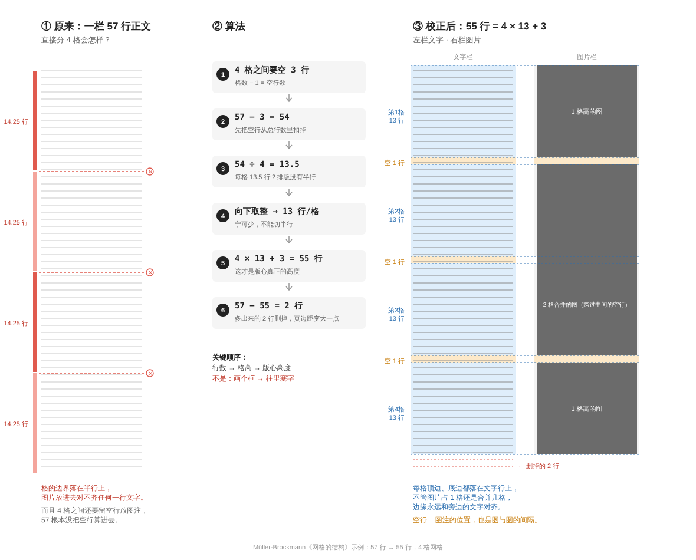

# baseline-to-layers

一个 [Agent Skill](https://agentskills.io)：**从一个正文字号推出整个页面的空间系统，并保证写出的 HTML/CSS 能原样转成 Figma 设计稿。**

An Agent Skill that derives a page's entire spatial system from one body type size — baseline grid, type scale, spacing, margins — and keeps the resulting HTML/CSS losslessly translatable into Figma layers. Method after Josef Müller-Brockmann's *Grid Systems in Graphic Design*.

名字就是整条线：**baseline**（正文行距定下的基线网格，一切纵向尺寸的基数）→ 空间系统 → **layers**（能被无损翻译成图层树的代码）。



## 覆盖范围

| 层 | 内容 | 分册 |
|---|---|---|
| 版面 | 正文行距基数、字阶生成与行距倍率、栏/格计算、版心高度、图片与卡片高度、页边距、响应式重算、中文排版、Figma 变量导出 | `baseline-grid.md` |
| 组件 | rem 间距刻度、层级关系、按钮比例、容器呼吸感、圆角 | `spacing.md` |
| 代码·生成期 | 写 demo 时的三条硬规则（flex / gap / 语义 class） | `figma-structure.md` |
| 代码·导出期 | 转 Figma 前 13 项走查、报告格式、项目固定尺寸表 | `figma-export-checklist.md` |

`SKILL.md` 只做路由和三层之间的冲突规则，每次只读当前任务需要的分册，所以不会拖慢生成速度。

## 核心方法

```
正文行距 L  →  字阶行距 = n × L  →  每格行数 r = floor((N − (k−1)×g) / k)  →  格高 r×L  →  版心高度
```

书里的原例：一栏 57 行，分 4 格 → 扣掉 3 个空行 → 54 ÷ 4 = 13.5 → 取 13 → **4×13+3 = 55 行**。版面高度是算出来的，不是先画框再塞字。

三层之间的衔接规则（纵向只取 L 的倍数、横向随 rem 刻度、小组件豁免、项目固定尺寸优先、网格用 flex 表达）写在 `SKILL.md`。

## 安装

### Claude Code

```bash
# 个人（所有项目可用）
git clone https://github.com/YEYE0516/baseline-to-layers ~/.claude/skills/baseline-to-layers

# 或放进某个项目（随仓库提交，团队共享）
git clone https://github.com/YEYE0516/baseline-to-layers .claude/skills/baseline-to-layers
```

### claude.ai / Cowork

从 [Releases](https://github.com/YEYE0516/baseline-to-layers/releases) 下载 zip，在 Settings → Capabilities → Skills 上传。

### 其他支持 Agent Skills 标准的工具

整个文件夹放进该工具的 skills 目录即可。

## 项目级配置（可选）

在你的项目里建 `.claude/layout-project.md`，写上根字号、L、变量前缀、固定尺寸表、组件库链接，skill 会优先读它。模板在 `figma-export-checklist.md` 第二节。

## 使用

直接描述任务即可触发，也可以点名：

```
用 baseline-to-layers 算一下：正文 16/24px，内容区高 1080px，分 4 格、4 栏
```

```
按 baseline-to-layers 给这个卡片列表定间距和圆角
```

```
准备把这个 demo 转 Figma，先走查一遍
```

## 文件

```
baseline-to-layers/
├── SKILL.md                    ← 路由 + 冲突规则
├── baseline-grid.md            ← 版面层
├── spacing.md                  ← 组件层
├── figma-structure.md          ← 代码层·生成期
├── figma-export-checklist.md   ← 代码层·导出期
├── README.md
├── LICENSE
├── 57-to-55-lines.png
└── 57-to-55-lines.svg
```

## 参考

- Josef Müller-Brockmann, *Grid Systems in Graphic Design / Raster Systeme für die visuelle Gestaltung*, Niggli, 1981
- 中文版：《平面设计中的网格系统》，上海人民美术出版社，2016

## License

MIT
